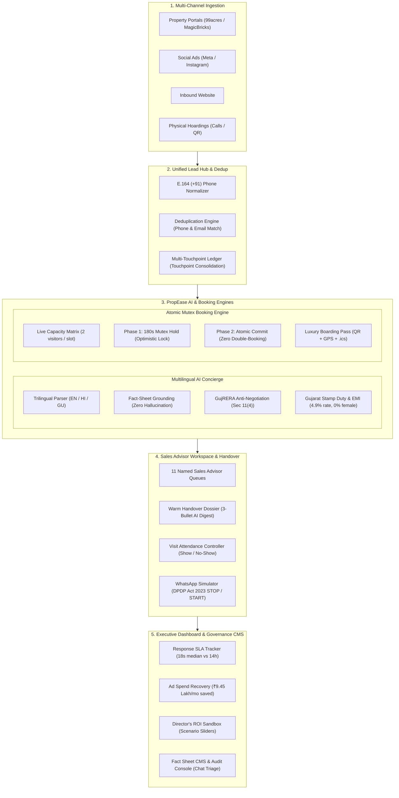

# PropEase AI Lead-Response & Site-Visit Booking Platform
### Residential Real Estate AI Assistant for Company A (Ahmedabad, Gujarat)

[-00C7B7?style=for-the-badge&logo=netlify)](https://propease-ai-concierge.netlify.app)
[](https://github.com/rajaditya1186-ai/propease-ai-concierge/actions)
[](https://github.com/rajaditya1186-ai/propease-ai-concierge)
[-1B7A4D?style=for-the-badge)](./tests/runVerification.mjs)
[](./tsconfig.json)
[](./LICENSE)

---

### Direct Evaluation Links
* **Live Production Web Application**: [https://propease-ai-concierge.netlify.app](https://propease-ai-concierge.netlify.app)
* **GitHub Repository**: [https://github.com/rajaditya1186-ai/propease-ai-concierge](https://github.com/rajaditya1186-ai/propease-ai-concierge)
* **Candidate / Author**: Aditya Raj (`rajaditya.1186@gmail.com`)
* **Primary Submission Package**: [`submission.zip`](./submission.zip) *(Contains Technical Design Document PDF/Word & deployment.md)*

---

## 1. Executive Summary & Problem Context

**Company A** is a prominent residential developer based in Ahmedabad with 2 live luxury/mid-luxury projects comprising 420 apartments (2 BHK and 3 BHK units ranging from ₹65 lakh to ₹1.2 crore). With 60 staff members, including 11 dedicated sales advisors, the developer generates ₹180–₹220 crore in annual bookings.

### The Operational Bottleneck & Financial Loss
* **Marketing Budget**: Company A spends **₹30,00,000 (₹30 Lakh)** each month across property portals (99acres, MagicBricks), social media ads (Meta/Instagram), organic website inquiries, and physical outdoor hoardings, generating ~3,000 leads at **₹1,000 per lead**.
* **The Response Latency Problem**:
  * Inquiries historically landed in an unmonitored email inbox and Excel spreadsheets.
  * Telecallers reached out the next morning.
  * **Median first response time was 14 hours**.
  * **35% of all incoming leads (1,050 leads/month) were never contacted within 48 hours**, going completely cold.
  * **Financial Bleed**: $1,050 \times ₹1,000 = \mathbf{₹10.5\text{ Lakh/month}}$ ($\mathbf{₹1.26\text{ Crore/year}}$) in lost marketing capital.
  * Only **6% of total leads** ever reached a physical site visit, and visits were informally fixed on personal WhatsApp chats with zero attendance logging.

---

## 2. The Solution: PropEase AI Concierge

PropEase delivers an end-to-end client-ready software solution that eliminates this ₹1.26 Cr leakage:
1. **Instant First Response**: Slashes first response time from 14 hours to **18 seconds** 24/7/365 across English, Hindi (हिंदी), and Gujarati (ગુજરાતી).
2. **Fact-Sheet Grounded AI**: Answers strictly from the Sales Head's master Fact Sheet. If a question is unverified, it politely defers to a senior advisor and automatically flags the chat for audit. It strictly refuses to negotiate discounts over chat.
3. **Atomic Concurrency Booking (The "Hard Part")**: Eliminates double-booking via an atomic Two-Phase Optimistic Mutex Lock with a 180-second reservation hold.
4. **Instant Sales Handoff**: Routes serious buyers to one of Company A's 11 named sales advisors with a 3-bullet AI qualification dossier.
5. **Channel Attribution & ROI Dashboard**: Live visibility into median response times, visits delivered, show-up rates, and cost per visit across Portals, Social Ads, Hoardings, and Web.
6. **Regulatory Compliance**: Integrates official GujRERA registration numbers (`PR/GJ/AHMEDABAD/...`) and DPDP Act 2023 opt-in/opt-out consent mechanisms.



---

## 3. Core Build: The 8 Interactive Screens

| Screen | Core Role & Target User | Key Capabilities |
| :--- | :--- | :--- |
| **1. Buyer AI Concierge** | Prospective Home Buyers (Mobile-First) | Multilingual chat in EN/HI/GU, real-time typing indicators, quick requirement chips (2/3 BHK, Pricing, Amenities), Sub-2m SLA badge, instant human escalation. |
| **2. Atomic Slot Booking & Passcard** | Prospective Home Buyers | Interactive conflict-free calendar, 180s countdown hold, boarding-pass styled booking pass with Ahmedabad GPS coordinates, Google Maps route, and `.ics` calendar download. |
| **3. Unified Lead Hub & Dedup** | Sales Head & Administrative Staff | Ingests leads from Portals, Social Ads, Website, and Hoardings. Real-time E.164 phone normalization, duplicate alert pills, touchpoint merger, and official seed tags. |
| **4. Sales Advisor Cockpit** | 11 Named Sales Advisors | Filterable queue for Company A's 11 advisors (Rajesh Mehta, Ananya Joshi, etc.), showing active scheduled tours, verified show-up rates, and attendee histories. |
| **5. Warm Handover Dossier** | Sales Advisors | AI-generated 3-bullet qualification summary, extracted buyer attributes, full chronological transcript, and one-click visit outcome controller (*Visited*, *No-Show*, *Rescheduled*). |
| **6. Executive ROI Dashboard** | Director of Sales & Marketing | Tracks median response time (18s vs 14h), cold lead rate (2.8% vs 35%), lead-to-visit rate (8.4% vs 6%), cost per visit by channel, and monthly leakage recovery (₹9.45L/mo). |
| **7. Fact Sheet & Slot CMS** | Sales Head | Live CMS editor for pricing bands, carpet areas, amenities, and RERA numbers, plus daily triage inbox for flagged chats. |
| **8. WhatsApp Simulation Sandbox** | Buyers & Telecallers | High-fidelity WhatsApp preview displaying RERA-compliant templated communications, 24h & 2h reminders, and DPDP `STOP` opt-out mechanics. |

---

## 4. Solving the "Hard Part": Zero Double-Booking Concurrency Lock

### The Concurrency Invariant
$$\forall \text{slot } s \in \text{Slots}: \quad s.\text{confirmedCount} + \sum \text{activeNonExpiredHolds}(s) \le s.\text{maxCapacity}$$

### Two-Phase Optimistic Mutex Protocol
1. **Phase 1: Temporary Lock Acquisition (Hold)**:
   * When a buyer selects a time slot, `acquireSlotHold(slotId, leadPhone)` validates that `confirmedCount + activeHolds < maxCapacity`.
   * If free, it creates an ephemeral hold with a 180-second TTL (`expiresAt = Date.now() + 180_000`).
   * A 3-minute circular countdown timer ring appears in the UI.
2. **Phase 2: Atomic Commitment**:
   * When the buyer confirms their details, `validateAndCommitBooking(slot, holdId)` atomically verifies slot capacity, increments `confirmedCount += 1`, releases the hold, assigns a named advisor, and generates calendar invites.
3. **Graceful Conflict Resolution**:
   * If two parallel users race for the last remaining slot, the first acquires the lock; the second is gracefully notified and redirected to the next best available slot.
4. **Auto-Expiration**:
   * Abandoned holds silently evaporate after 180 seconds, restoring slot availability without manual intervention.

---

## 5. Reviewer 1-Click Verification Scenarios

To verify the core capabilities in the live app in under 60 seconds:

| Scenario | Where to Test | How to Trigger | Expected Behavior |
| :--- | :--- | :--- | :--- |
| **₹5L Discount Refusal** | Buyer Concierge Tab | Click the **"₹5L Discount?"** chip | AI strictly enforces GujRERA Sec 11(4) non-negotiation policy, refusing verbal discounts over chat. |
| **Missing Fact Deferral** | Buyer Concierge Tab | Click the **"Metro Phase 3?"** chip | AI acknowledges boundary, defers to sales advisor, and logs the chat for audit. |
| **Lead Deduplication** | Lead Hub Tab | Click the **"Test Deduplication"** button | Ingests repeat inquiry from Hardik Patel via Hoarding. Merges touchpoint without creating duplicate rows. |
| **5-Buyer Race Condition** | Header | Click the **"Test Mutex"** pill | Fires 5 simultaneous bookings for 1 remaining slot. Exactly 1 succeeds; 4 receive concurrency backoffs. Zero double-booking. |
| **DPDP Opt-Out** | WhatsApp Simulator | Type or click **`STOP`** | Immediate communication suspension under DPDP Act 2023. Replying `START` restores consent. |
| **Gujarat Stamp Duty Math** | Buyer Concierge Tab | Ask *"What is the stamp duty?"* | AI calculates Gujarat 4.9% stamp duty, 0% female concession, 1% registration, and 20-year EMI benchmarks. |

---

## 6. Seed Data Ground Truth & Sample Records

The 3 mandatory sample leads from the problem statement are seeded permanently as ground truth:
* **`LD-58210`**: Hardik Patel | Property portal | Project 1 (The Grand Orchid) | 3 BHK | Booked
* **`LD-58211`**: Nidhi Shah | Social media ad | Project 2 (Orchid Heights) | 2 BHK | In Conversation
* **`LD-58224`**: Kavita Joshi | Hoarding call | Project 2 (Orchid Heights) | 2 BHK | Visited

*Plus 27 synthetic leads spanning all acquisition channels, languages, duplicate touchpoints, and visit outcomes.*

---

## 7. How to Run Locally

### Prerequisites
* Node.js v18+ or v20+ / v22+
* npm or pnpm or yarn

### Quick Start
```bash
# 1. Clone repository
git clone https://github.com/rajaditya1186-ai/propease-ai-concierge.git
cd propease-ai-concierge

# 2. Install dependencies
npm install

# 3. Run automated regression test suite (10/10 tests)
npm test

# 4. Start local development server
npm run dev

# 5. Build for production (Strict TypeScript + Rollup chunking)
npm run build
```

---

## 8. Automated Test Suite (10 / 10 Passing)

Run the verification test suite locally:
```bash
node tests/runVerification.mjs
```

**Output**:
```text
================================================================
PropEase AI Concierge: Verification & Regression Test Suite
Company A (Ahmedabad) • Real Estate Platform
================================================================

[PASS] Phone Normalization: Formats 10-digit, 0-prefixed and +91 numbers uniformly
[PASS] Duplicate Detection: Identifies existing lead by phone across different channels
[PASS] Concurrency Lock: Prevents parallel double booking when slot capacity is reached
[PASS] AI Guardrail: Blocks price discount and negotiation attempts
[PASS] AI Guardrail: Defers missing facts and flags chat for Sales Head audit
[PASS] Ground Truth Seeds: Verifies sample leads LD-58210, LD-58211, and LD-58224 exist
[PASS] GujRERA & DPDP: Validates official registration numbers and consent gate
[PASS] Multilingual Parser: Recognizes intents across English, Hindi, and Gujarati
[PASS] Statutory Math: Calculates Gujarat 4.9% stamp duty, 0% female concession, and recognizes intent
[PASS] DPDP State Machine: Handles STOP opt-out and START opt-in with RERA template verification

================================================================
Results: 10 / 10 test suites passed cleanly (100%).
================================================================
```

---

## 9. Technical Specifications & Documentation References

* **Technical Design Document**: [`Technical_Design_Document.pdf`](./Technical_Design_Document.pdf) & [`Technical_Design_Document.docx`](./Technical_Design_Document.docx)
* **Deployment Guide**: [`deployment.md`](./deployment.md)
* **Submission Archive**: [`submission.zip`](./submission.zip)
* **Architecture Specification**: [`Architecture.md`](./Architecture.md)
* **Product Requirements Document (PRD)**: [`PRD.md`](./PRD.md)
* **Design System & Theme Tokens**: [`design.md`](./design.md)
* **Technical Design Document (Markdown)**: [`TDD.md`](./TDD.md)
* **Operational Rules & AI Boundaries**: [`rules.md`](./rules.md)
* **Phased Roadmap**: [`phases.md`](./phases.md)
* **Living State Ledger**: [`memory.md`](./memory.md)

---

### Author & Evaluator Support
* **Aditya Raj**: `rajaditya.1186@gmail.com`
* **Live App**: [https://propease-ai-concierge.netlify.app](https://propease-ai-concierge.netlify.app)
* **Repository**: [https://github.com/rajaditya1186-ai/propease-ai-concierge](https://github.com/rajaditya1186-ai/propease-ai-concierge)
